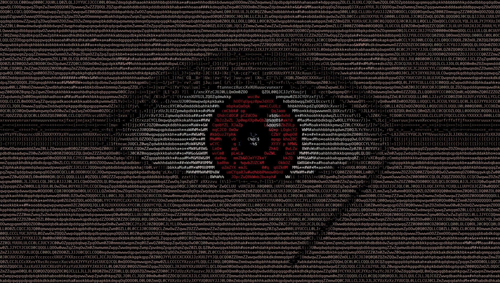
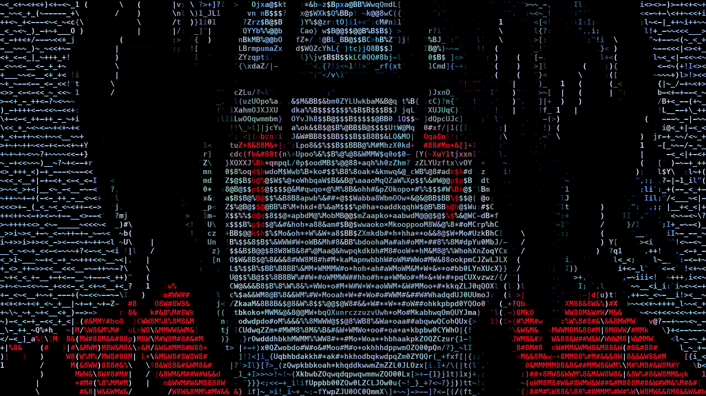
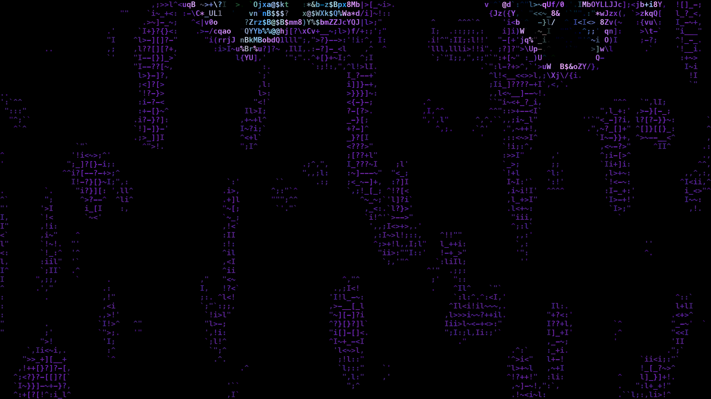

# ASCII Sharingan

A 36-second looping animation drawn entirely with coloured text characters. The eye and the flames are computed from maths in Python; the scene inside the pupil is a painting converted to characters cell by cell. Everything is painted as a grid of ASCII glyphs.



## The loop

1. An eye opens: a red Sharingan with three tomoe on a ring. It glances around.
2. The tomoe spin up, the eye blinks, and it reopens as a Mangekyō pinwheel. Blood runs down the cheek.
3. The camera dives into the pupil, where Itachi stands in the rain, his hair stirring. It pushes in on his face and blood runs from both eyes.
4. Black flames climb the screen, swallow the scene, then lift away to reveal the eye again. It closes.

| | |
|---|---|
|  |  |
|  | |

## Run it

Needs Python 3 with tkinter. On macOS with Homebrew Python: `brew install python-tk@3.12`.

```sh
python3 -m venv .venv
.venv/bin/pip install -r requirements.txt
./run.sh
```

Keys: `space` pauses, `q` or `Esc` quits.

### The picture in the pupil

The scene inside the pupil is converted from a reference picture at `ref/itachi_0.jpeg`, which is not included in this repo because the artwork is not mine to redistribute (see Credits). Put your own picture there and adjust the `PHOTO_*` settings at the top of `main.py` (framing, face position, eye positions) to match it. Without a picture the program falls back to a simple drawn portrait.

## Export a video

```sh
.venv/bin/python export.py                      # writes sharingan.mp4 (1920x1080, 30 fps)
.venv/bin/python export.py --png 24 frame.png   # one frame, at t = 24 s
```

## How it works

- `main.py` computes, for every cell of a character grid, a brightness and a colour. Brightness picks a glyph from a 70-character density ramp; colour is quantised to 12 bits.
- The eye is layered signed shapes and value noise: eyelids, lashes, iris, and the pupil as a "window". The flames are a scrolling noise field.
- Inside the pupil, each cell samples the reference picture: brightness sets how dense the glyph is and the picture sets its colour. The hair ripple is a small moving warp of the sample positions, limited to the loose hair; the rain and the blood are drawn on top.
- A single camera zoom ties it together, so the scene is already there inside the pupil from the first frame, just too small to see.
- The live window uses one tkinter canvas text item per cell and only updates cells that changed, with an adaptive per-frame budget.
- `export.py` skips the window and composites glyph bitmaps with numpy, piping frames to ffmpeg.

## Credits

The Itachi scene is converted from a painting signed "Art by Aoi Ogata"; all credit for that artwork goes to the artist. Inspired by an ASCII eye animation by `ch20f3rst` on TikTok. Directed by Noah Kerr and written with [Claude Code](https://claude.com/claude-code).

This is a fan project. Naruto and its characters belong to Masashi Kishimoto and their respective rights holders; this project is not affiliated with or endorsed by them.
