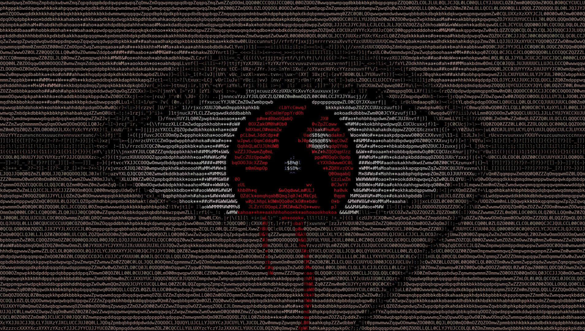
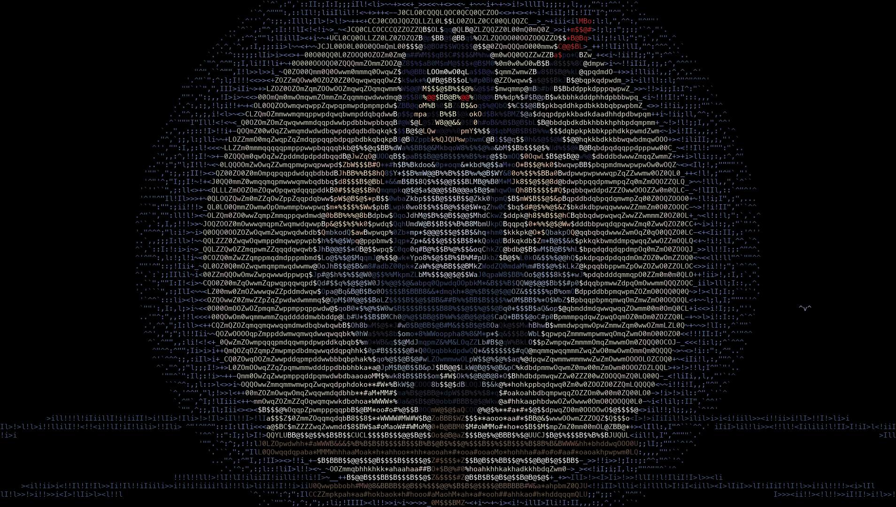

# ASCII Sharingan

A 36-second looping animation drawn entirely with coloured text characters. No images, no video assets: every frame is computed from maths in Python and painted as a grid of ASCII glyphs.


## The loop

1. An eye opens: a red Sharingan with three tomoe on a ring. It glances around.
2. The tomoe spin up, the eye blinks, and it reopens as a Mangekyō pinwheel. Blood runs down the cheek.
3. The camera dives into the pupil, where a figure crouches on a utility pole in front of a full moon.
4. Black flames climb the screen, swallow the scene, then lift away to reveal the eye again. It closes.

| | |
|---|---|
|  |  |
|  | |

## Run it

Needs Python 3 with tkinter. On macOS with Homebrew Python: `brew install python-tk@3.12`.

```sh
python3 -m venv .venv
.venv/bin/pip install -r requirements.txt
./run.sh
```

Keys: `space` pauses, `q` or `Esc` quits.

## Export a video

```sh
.venv/bin/python export.py                      # writes sharingan.mp4 (1920x1080, 30 fps)
.venv/bin/python export.py --png 24 frame.png   # one frame, at t = 24 s
```

## How it works

- `main.py` computes, for every cell of a character grid, a brightness and a colour. Brightness picks a glyph from a 70-character density ramp; colour is quantised to 12 bits.
- The scene is layered signed shapes and value noise: eyelids, lashes, iris, the pupil as a "window", the moon, the figure built from about 30 tapered strokes and ellipses, and a scrolling noise field for the flames.
- A single camera zoom ties it together, so the moon scene is already there inside the pupil from the first frame, just too small to see.
- The live window uses one tkinter canvas text item per cell and only updates cells that changed, with an adaptive per-frame budget.
- `export.py` skips the window and composites glyph bitmaps with numpy, piping frames to ffmpeg.

## Credits

Inspired by an ASCII eye animation by `ch20f3rst` on TikTok. Directed by Noah Kerr and written with [Claude Code](https://claude.com/claude-code).

This is a fan project. Naruto and its characters belong to Masashi Kishimoto and their respective rights holders; this project is not affiliated with or endorsed by them.
